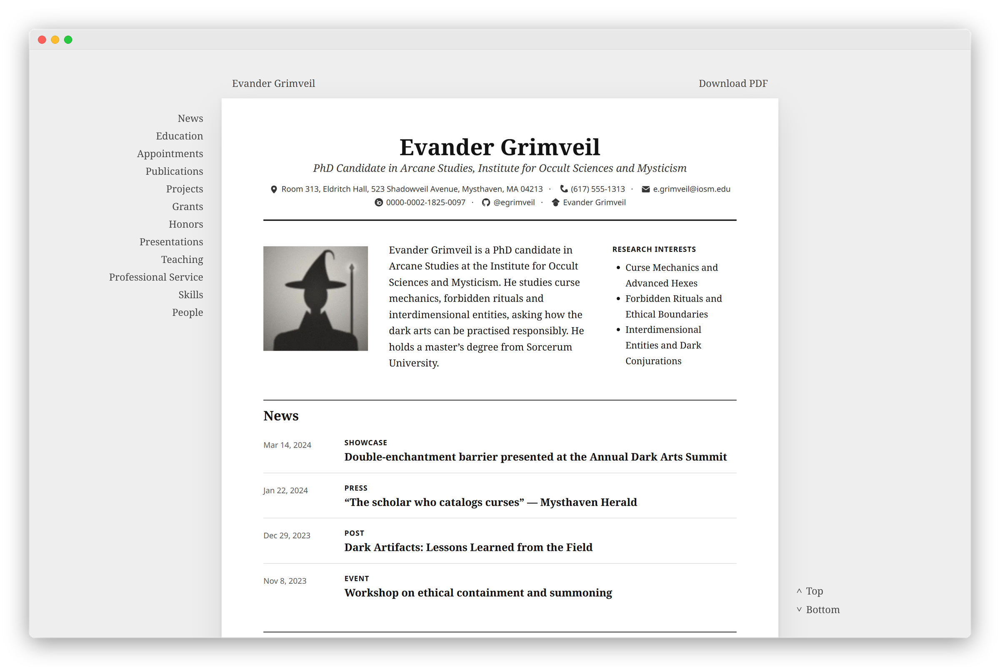

# Hugo Theme: Live CV

*Live CV* is a Hugo theme for academic-style online curricula vitae. It lays your CV out like a printed broadsheet: a white page on a grey desk, serif headlines, hairline rules, and your projects presented as illustrated stories.

## Demo

A live demo, built from [exampleSite](exampleSite) and featuring the fictional Evander Grimveil, is hosted on [GitHub Pages](https://ziruifan.github.io/hugo-theme-live-cv).



## Features

- **Section nav bar**: generated automatically from the sections you show, in the margin beside the page.
- **Data-driven CV**: each section (education, appointments, grants…) is a small YAML file in `data/`. You choose the order, show each section at full or half width, switch sections off, and add your own.
- **Projects as stories**: main projects as full-width stories with a large photo, side projects as cards a third of the width, and a full article page for each project with contributions, linked publications and "More Projects".
- **News**: dated posts, press, events and showcases. The category is shown above each headline, and a headline can link straight to an external article.
- **Publications**: free-form Markdown citations in any style, grouped by type, with your name highlighted automatically and DOI links.
- **Light and dark**: in dark mode the desk around the page turns dark while the paper stays white, like a printed CV. It follows the visitor's system setting, or can be forced to either.
- **Print-ready**: printing the home page gives a clean paper CV.
- **Fast**: self-hosted fonts (about 120 KB), responsive WebP images generated by Hugo, and almost no JavaScript (one small inline script tidies the contact line when it wraps).

## Requirements

Hugo **0.146.0** or later (the standard edition is enough).

## Installation

From the root of your Hugo site:

```bash
git submodule add https://github.com/ziruifan/hugo-theme-live-cv.git themes/hugo-theme-live-cv
```

Then set `theme = 'hugo-theme-live-cv'` in your `hugo.toml`.

To preview the example site from inside the theme folder:

```bash
cd exampleSite
hugo server --themesDir ../..
```

## Site structure

```
.
├── hugo.toml               # site settings and section order
├── assets/images/          # portrait (resized automatically)
├── data/                   # your CV, one file per section
│   ├── profile.yaml
│   ├── education.yaml
│   ├── publications.yaml
│   └── …
└── content/
    ├── projects/
    │   └── my-project/
    │       ├── index.md
    │       └── cover.jpg
    └── news/
        └── my-post/
            └── index.md
```

## Configuration

```toml
title = 'Your Name'
theme = 'hugo-theme-live-cv'
copyright = 'Copyright © {year} Your Name'   # {year} is replaced with the current year

[params]
  description = 'One sentence for search engines.'
  colorScheme = 'auto'      # 'auto', 'light' or 'dark'
  # desk = '#F5F2EA'        # background around the page in light mode
  # pdf = 'cv.pdf'          # adds "Download PDF" to the home page (file in static/)
  # attribution = false     # hides "Powered by Hugo & Live CV"
  # navbar = false          # hides the section links in the left margin
  # scrollButtons = false   # hides the Top/Bottom links in the right margin
  # updated = 2026-11-01    # shows "Updated November 2026" below the page; hidden when not set

  [params.home]
    news = 4                # latest news items on the home page
    projects = 0            # projects on the home page (main projects first); 0 shows all
    sections = [
      { key = 'about' },
      { key = 'news' },
      { key = 'education' },
      { key = 'appointments' },
      { key = 'publications' },
      { key = 'projects' },
      { key = 'grants', width = 'half' },     # consecutive half-width sections sit side by side
      { key = 'honors', width = 'half' },
      { key = 'presentations' },
      { key = 'teaching', width = 'half' },
      { key = 'service', width = 'half' },
      { key = 'skills' },
      { key = 'people', enable = false },     # switched off, but kept in the list
    ]

# Lets a standalone image with a title become a figure with a caption.
[markup.goldmark.parser]
  wrapStandAloneImageWithinParagraph = false
```

Each entry has a `key`: `about`, `news`, `projects`, `publications`, or the name of a data file (`data/<key>.yaml`). The optional settings are:

- `width`: `'full'` (default) or `'half'`. Consecutive half-width sections sit side by side; on small screens every section is full width. In wide sections dates sit on the right; in half-width ones they go below each entry.
- `enable = false`: hides the section without removing it from the list.

A plain string such as `'news'` is short for `{ key = 'news' }`.

The nav bar in the margin left of the page is generated from this list: it links to every section that is enabled and has content, in the same order and with the same headings, and stays in view while scrolling. On other pages its links lead back to the home page. It needs a window at least 1340px wide and is hidden on smaller screens. Sections with no data file or no content are skipped, so you can keep the default list and fill in only what you need.

## Your profile

`data/profile.yaml` fills the masthead and the "about" block:

```yaml
name: Your Name
position: PhD Candidate in Subject          # optional, shown under the name
affiliation: Your University                # optional, shown after the position
portrait: images/portrait.jpg   # in assets/ or static/, or a full URL
bio: >-
  Markdown. Separate paragraphs with a blank line.
contacts:                       # first line under the name
  - text: Room 101, Building, City
    icon: location
  - name: Office                  # shown as "Office: …"
    text: +1 555 0100
    url: tel:+15550100
    icon: phone
interests:
  - First research interest
links:                          # second line, same fields as contacts
  - name: ORCID
    icon: orcid
    text: 0000-0000-0000-0000
    url: https://orcid.org/0000-0000-0000-0000
  - name: GitHub
    text: '@yourname'             # quote values that start with @
    url: https://github.com/yourname
  - name: Google Scholar          # without text, the name itself is the link
    url: https://scholar.google.com/…
```

**Contacts and links** use the same fields, all optional: `name` (a label, shown as "name: text"), `icon`, `text` (the value) and `url`. With a `url`, the text becomes the link; without `text`, the name is shown on its own and becomes the link. A contact can also be a plain Markdown string.

**Icons.** Contacts and links can show a small solid icon before them with `icon:`. The theme includes `email`, `phone`, `location`, `website`, `link`, `orcid`, `linkedin`, `youtube`, `github` and `google-scholar`. To use another one, put an SVG at `assets/icons/<name>.svg` in your site and use its name; use a solid (filled) icon to match the set, and give it `fill="currentColor"` so it takes the text colour. The GitHub and Google Scholar marks come from [Simple Icons](https://simpleicons.org) (CC0); they and the YouTube mark are trademarks of their owners.

**Separators.** Contacts and links are separated by `·`. Change it with `contactSeparator` in `[params]`, e.g. `contactSeparator = '|'`, or `contactSeparator = ''` for spacing only.

## CV sections

Each key in `params.home.sections` (other than `news`, `projects` and `publications`) reads `data/<key>.yaml`. A file can be a plain list:

```yaml
# data/education.yaml
- title: Ph.D. in Subject
  organization: University, City
  start: 2020
  end: Present          # "Present" is translated automatically
```

…or a map, to set a custom heading and layout:

```yaml
# data/fellowships.yaml
title: Fellowships
layout: honors
items:
  - title: Big Fellowship
    organization: A Foundation
    time: 2021
```

All text fields accept Markdown. Every entry can use either `start`/`end` or a single `time`.

| Layout    | Looks like                                   | Fields                                   | Default for                         |
|-----------|----------------------------------------------|------------------------------------------|-------------------------------------|
| `entries` | **Title** ⟷ date, organization below          | title, organization, description, url    | education, appointments, employment |
| `stacked` | **Title**, details, date underneath           | title, organization, url                 | grants, teaching                    |
| `honors`  | **Title**, Organization ⟷ date                | title, organization, url                 | honors, awards                      |
| `talks`   | “Title.” *Venue*, Location ⟷ date             | title, venue, location, url              | presentations, talks                |
| `list`    | bullet points                                 | Markdown strings                         | service                             |
| `skills`  | labeled groups in columns                     | category, items (list or string)         | skills                              |
| `people`  | grid of names, split into groups              | name, url, group, role, affiliation      | people, collaborators               |

Unknown keys use `entries`. You can add your own layout by creating `layouts/_partials/sections/<name>.html` in your site.

### People

```yaml
# data/people.yaml
- name: Your Supervisor
  group: Supervisor              # groups get a small heading, in order of first use;
                                 # it reads "Supervisors" when the group has more than one person
  url: https://…
  affiliation: Department, University
- name: A Collaborator
  group: Collaborators
  affiliation: Lab, Institute
```

### Publications

```yaml
# data/publications.yaml
highlight: Surname, I.          # a name or list of names to set in bold
items:
  - id: paper2024               # referenced by projects
    type: Journal Articles      # group heading; groups appear in order of first use
    selected: true              # show on the home page
    citation: 'Surname, I., & Other, A. (2024). Title. *Journal*, 1(2), 3–4.'
    doi: 10.1234/abcd
    links:
      - name: PDF
        url: https://…
```

If no entry is marked `selected`, the home page shows them all.

## Projects

```bash
hugo new content/projects/my-project/index.md
```

```toml
+++
title = "Project Title, Written as a Headline"
linkTitle = "Short Title"          # optional, used in breadcrumbs
date = 2024-06-01                   # projects are ordered by weight, then date (newest first)
tags = ["Topic"]                    # shown above the headline
summary = "One or two sentences: the question and the short answer."

[params]
  main = true                       # a main project: full-width story with a large photo
  start = 2022
  end = "Present"
  collaborators = ["Name", "Another Name"]   # linked if listed in data/people.yaml
  contributions = ["Key outcome one.", "Key outcome two."]
  publications = ["paper2024"]               # ids from data/publications.yaml

  [params.cover]                   # optional; cover.* or featured.* in the bundle is used by default
    alt = "What the photo shows"
    caption = "Caption under the photo on the project page."
+++

Body text in Markdown.


```

Projects with `main = true` are shown as full-width stories with the photo beside the text; you can have as many as you like. All other projects are side projects, shown as cards a third of the width with the photo below. Main projects come first, then side projects, each in date order (or by `weight`).

## News

```bash
hugo new content/news/my-post/index.md
```

```toml
+++
title = "Headline"
date = 2024-03-14
categories = ["Press"]                 # Post, Press, Event, Showcase… shown above the headline
summary = "Optional standfirst."
link = "https://example.com/article"   # optional: the headline links here instead
+++
```

## Translation

All interface text lives in [i18n/en.toml](i18n/en.toml). To translate it or rename a heading, copy any key into your site's `i18n/<lang>.toml`.

## Migrating from v1

Version 2 is a rewrite. Your content carries over, but the configuration moves:

| v1                                         | v2                                                                    |
|--------------------------------------------|-----------------------------------------------------------------------|
| `params.name`, `params.description`        | `data/profile.yaml`: `name`, `bio` (`params.description` is now only the meta description) |
| `params.contacts.list[].info`/`url`        | `data/profile.yaml`: `contacts[].text`/`url`                         |
| `params.interests.list[].interest`         | `data/profile.yaml`: `interests` (list of strings)                   |
| `params.links.list[]` (`platform`, `text`, `url`) | `data/profile.yaml`: `links[]` with `name` (was `platform`), `text`, `url` |
| `params.education/employment/teaching/awards` | `data/education.yaml`, `appointments.yaml`, `teaching.yaml`, `honors.yaml` (same fields; the `list` wrapper goes) |
| `params.publications.name`                 | `data/publications.yaml`: `highlight`                                 |
| `params.publications.list[]`               | `data/publications.yaml`: `items[]`, plus an optional `type`. Citations are now Markdown, so put the journal in `*…*` |
| `params.people`                            | `data/people.yaml`, with `group: Supervisor`, `group: Students`, `group: Collaborators` |
| `params.projects.enable`, `params.posts.*` | `params.home.sections`, `params.home.news`, `params.home.projects`   |
| `content/posts/`                           | `content/news/`; remove `type = "post"` and use `categories` for the label |
| projects: `type = "project"`               | remove; projects are recognized by their folder                       |
| projects: `abstract = "- a \n - b"`        | `contributions = ["a", "b"]`, plus a `summary`                        |
| custom layouts in `layouts/partials/`      | the theme now uses `layouts/_partials/` (Hugo 0.146+ template system) |

## License

The theme is released under the [MIT License](LICENSE). The bundled Noto Serif and Noto Sans fonts are licensed under the [SIL Open Font License](assets/fonts/OFL.txt), which is published next to the fonts (`/fonts/OFL.txt`) in every built site.
